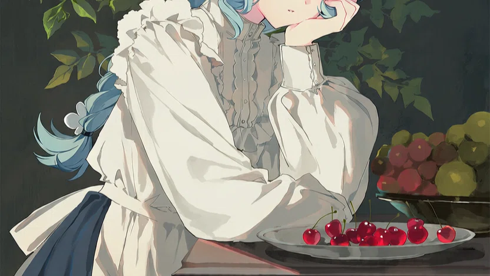

那时节春暮雨细，小城茶肆里人声稀薄，窗纸被潮气浸得发软，卖花声从巷口过来，又低低地过去。她坐在我对面，衣袖上沾着一点未干的雨意，先把茶盏轻轻转半圈，才低头去闻。盏是粗陶的，沿上磕掉一小块，她拇指就按在那一处。茶刚沏上，叶子还没沉，浮在上头，像一层薄薄的春。她闻得很久，眼睛垂着，鼻尖几乎贴着盏沿，热气把额前的碎发濡湿了一线；然后才啜一口，含住，不急着咽，等那一口热过去了，才轻轻把盏放下。放下时几乎没有声音。

我那时只觉日子长得很，长到可以容我们把一壶茶从热喝到凉，再从凉续上热的。碟里的梅子她只动了一颗，余下的搁了一下午。

后来我才晓得，日子并不长。长的是人走以后，那些原封不动的记忆，回忆时的一个个黄昏。

如今茶肆还在，窗纸换了新的，卖花声也还是那个调子。茶老板的孩子有了出息，在城里安了家，要接老两口去享福；老板没去，仍旧每日坐在柜台后头，同茶客说这些事，说自己泡惯了茶，孩子有福气，就是他的福气。

我仍旧坐靠窗那张桌，仍旧要两盏茶。伙计起初问过一回，我答“等人”，他便不再问，只每回把另一只盏也烫得温温的。我有时把那只盏转半圈，有时不转。转不转，都没有人低头去闻了。

桌漆掉了，老板舍不得重漆，只拿布一遍一遍擦。街上的人来了又走，只有靠窗这张桌子和那两只盏，还在原地。

她话不多，拣些不轻不重的说：谁家院里的海棠开了，谁又搬去了城南。我也只说近来少雨，书页里生了细虫。我们都小心绕开那些年，仿佛绕开一只薄胎的瓷碗，怕一碰就碎。可如今想来，碎不碎的，到底也端了这些年。

那日她忽然笑出了声：“我的愿望现在实现了一半。”

我搁下茶盏：“还不够吗，剩下一半呢？”

她抬眼看我，灯影在睫上停了一停：“剩下的一半，坐在我对面。”

我一愣，不知道怎么答话，只把窗支开一线。风进来，吹得茶烟斜斜地散。那一刻我几乎要伸手去够什么，可手在袖中握了一握，终究只是替她把碟里的梅子推近些。我说：“梅子酸，少用些。”她应了一声，也不再言语。

她走时雨还没落下来。她带了一把伞，青竹的骨，收着，始终没撑开。我送到门边，只说了句“路滑”。她回头笑一笑，伞尖在青石上点了一点，便混进巷里的人影里，再也分不清。那时我以为不过是寻常一别，明日、后日、许多个明日，茶肆的窗下总还有她转茶盏的影子。

可只发生过一次的事，就等于没发生过。她剩下的一半愿望，我替她记着。记着记着，就像白衣上落了一点茶渍，洗过多少回，印子淡了，对着光看，仍在。那些年世道翻覆，人像水里的叶子，由不得自己。叶子顺水走了，岸上的人还站着。

所以那日茶烟、灯影、她低低的笑，都像不曾发生。也正因像不曾发生，才容我在往后许多个无事的黄昏里，一遍一遍地回想，一遍一遍地把它坐实。人真是奇怪，明明只见过一回，却像欠了一生。

去年春暮，我又坐回那张桌。碟里的梅子还是酸的，茶烟还是斜斜的。伙计照例烫了两只盏，我伸手把对面那只挪开半寸，又挪回来。窗纸外头有卖花声过去，我忽然想起她衣袖上那点潮气，想起她低头闻茶时，鬓边有一缕碎发落下来。这些细碎东西，从前不觉得，如今倒像茶渍渗进木纹里，擦不掉，也不舍得擦。

她留下的梨花还压在书页里，在我注意不到的时间里，偷偷染上了书页一样的黄色。我翻书时偶尔碰见，就停一停，再合上。没有落泪，也没有叹气，只是停一停。停一停，再接着看下一页。

我依稀记得，她喜欢用茶盏把花茶的细碎花瓣聚到一起，再轻轻抿下去。我笑话她说这是“吃茶”，她只莫名其妙回一句：“这花只开一次。”

我说：“明年还有。”

她把盏里的花瓣拢到一处，说：“明年开的是明年的花。这一朵，只开一次。”

她说这话时没抬头。我那时只当她是在说茶。

后来的后来，我也开始收集梨花，阴干，同茶叶一道封在锡罐里。封不严就返潮，打开时一股沤过的草气，只好倒掉。倒的时候我在窗前站了很久，也不是难过，只是不知道还能做什么。这才成。汤色极浅，花香浮在面上，一入口就散了，什么也留不住。我才明白，她为什么要把花瓣一点一点拢到一处再抿——散了，就尝不到。

我封得不多，一小罐，够泡七八回。梨花落的时候，扫一捧，拣干净的，摊在竹筛上晒。风大的日子，晒到一半就吹跑了，满院子都是，也就由它去。

伙计来续水，忽然问：“那位客人，还来么？”

我说：“难说。”

他站了一会儿，说：“她走那天，伞忘在门后头了。我收着的。”

我握着盏，没有作声。他又说：“店里翻修，东西挪来挪去，那把伞不知散到哪里去了。对不住。”

我说：“不碍事。”停一停，又道，“她本来也不爱撑伞。”

一个灾难发生的概率很低，低到你事后回想起都不愿意相信，这一粒微尘落到谁头上，就是一座山。如今才晓得，山压下来时并不轰然。它只是安安静静地压在你对面，空着一只茶盏，让你每回烫茶时，都多烫一只。

昨日我又去茶肆。伙计说，天暖了，明前茶快到了。我点点头，说：“还是要两盏。”他应了一声，转身去灶上提水。窗纸外头，卖花声又低低地过来。巷口那株梨树开得早，一树白，风一过，花瓣就往下落，落在青石上，像没人扫的雪。

“下一次梨花开，是什么时候？”

我思索着，伸手把对面那只盏转半圈，然后搁下，等茶来。

门外有人收了伞，伞尖在青石上点了一点。

雨落下来了。
